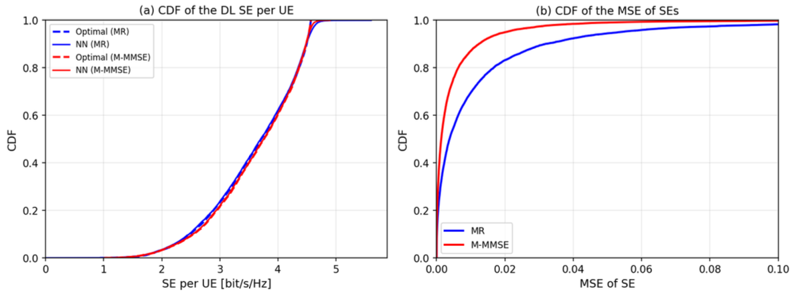
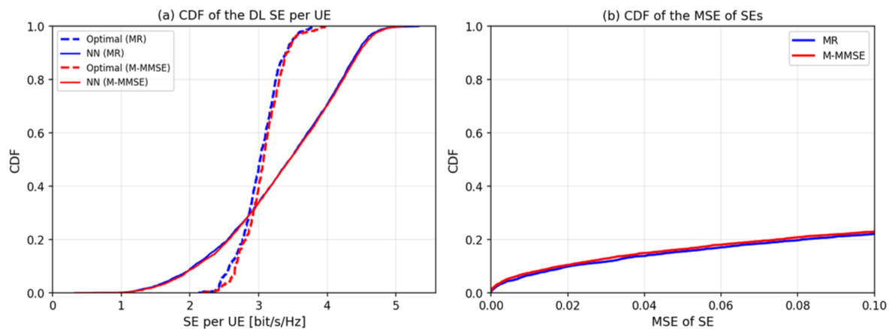
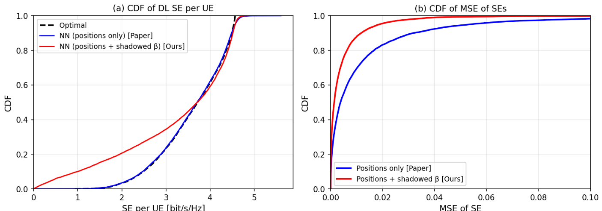
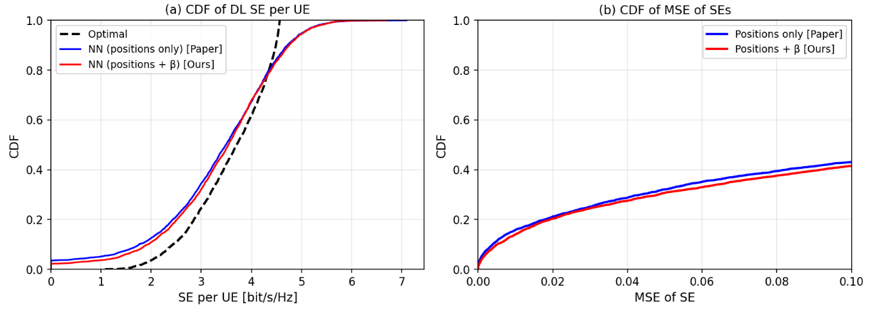
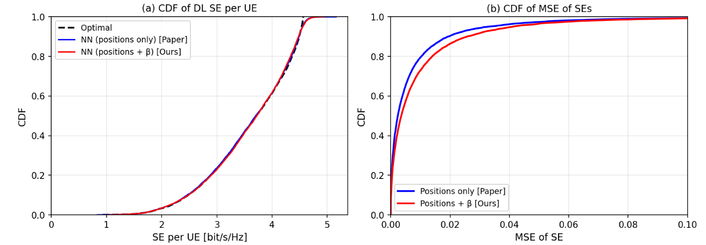
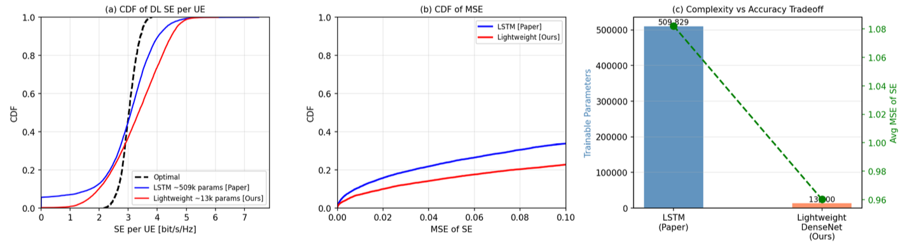
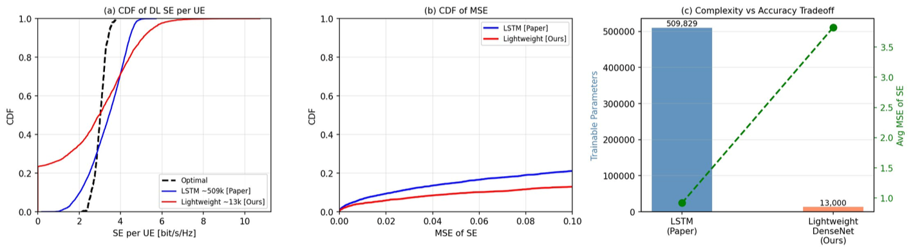

<div align="center">

# 📡 Deep Learning Power Allocation in Massive MIMO
### Reproduction + Two Extensions: Shadowed-β Inputs & a ~97% Lighter Architecture


*Course research project under **Dr. Suraj Srivastava**, IIT Jodhpur · Feb – May 2026*

</div>

---

## 🎯 TL;DR

The base paper, [Sanguinetti, Zappone & Debbah (arXiv:1812.03640)](https://arxiv.org/abs/1812.03640), shows that a neural network can map UE positions directly to optimal downlink power allocations, avoiding expensive optimization at run time.

I **reproduced** its results and then extended it in two directions:

| | Contribution | Result |
|---|---|---|
| 🔁 | **Reproduction** of max-prod and max-min allocation (MR & M-MMSE) | Max-prod average MSE of SE: **0.051 (MR)** and **0.007 (M-MMSE)** |
| 🌫️ | **Novelty 1:** add log-normal *shadowed large-scale fading (β)* to the input (40-D → 120-D, dual-stream DenseNet) | **70.1% lower MSE** than position-only input (0.01483 → 0.00443, MR, N = 5,000) |
| 🪶 | **Novelty 2:** replace the 509,829-parameter LSTM (max-min) with a **Lightweight DenseNet** | **~97% fewer parameters**, and higher accuracy once data is sufficient (**91.29% vs 86.58%** at N = 5,000) |

📄 Full write-up: [`docs/Extended_Paper.pdf`](docs/Extended_Paper.pdf)

---

## 🔁 1. Baseline Reproduction

**Max-product** (6,373-parameter DenseNet): the network tracks the optimal solution closely, and M-MMSE is easier to learn than MR.

<p align="center"></p>

**Max-min** (509,829-parameter LSTM): accuracy is satisfactory, with a visible gap to optimal, consistent with max-min being the harder problem.

<p align="center"></p>

---

## 🌫️ 2. Novelty 1: Shadowed-β as Network Input

With a deterministic path-loss model, two UEs at the same position get identical β and identical power. Adding log-normal shadowing (σ = 6 dB) and feeding the shadowed β to the network, alongside the positions, gives it channel information positions cannot encode. The **same** shadowing realization is used for both the inputs and the optimal-power labels, and the β inputs are normalized with global training-set statistics.

<p align="center"></p>

<details>
<summary><b>🧪 The failed attempts that led to the final design (click to expand)</b></summary>
<br/>

**Attempt 1: clean β as extra input, labels unchanged.** Only a modest ~15% MSE improvement, since clean β is largely redundant with positions.

<p align="center"></p>

**Attempt 2: inconsistent shadowing between training and evaluation.** Performance got **25.4% worse** than the baseline, which showed that consistency between inputs and labels is essential.

<p align="center"></p>

</details>

---

## 🪶 3. Novelty 2: Lightweight DenseNet vs LSTM (Max-Min)

A feedforward net (128 → 64 → 32 → 5) replaces the LSTM. Its accuracy depends strongly on training-set size.

**N = 800:** the LSTM wins.

<p align="center"></p>

**N = 5,000:** the Lightweight DenseNet wins.

<p align="center"></p>

| Model (MR precoder) | Params | N = 800 acc. | N = 800 MSE | N = 5,000 acc. | N = 5,000 MSE |
|---|---|---|---|---|---|
| LSTM (baseline) | 509,829 | **92.15%** | 0.230 | 86.58% | 0.753 |
| Lightweight DenseNet (ours) | ~16k | 74.63% | 1.822 | **91.29%** | 0.271 |

**Takeaway:** the LSTM's recurrent structure helps when labelled data is scarce, while the far smaller feedforward network generalizes better when data is plentiful, at a fraction of the deployment cost.

---

## 📂 Repository Structure

```
├── notebooks/
│   ├── 01_reproduction_numpy_prototype.ipynb
│   ├── 02_reproduction_keras.ipynb
│   ├── 03_novelty_exploration.ipynb
│   ├── 04_novelty1_shadowed_beta_final.ipynb
│   └── 05_novelty2_small_data_N800.ipynb
├── docs/
│   ├── Extended_Paper.pdf
│   └── Base_Paper_arXiv_1812.03640.pdf
├── assets/            # figures used in this README
└── README.md
```

| Notebook | What it does | Run |
|---|---|---|
| `01_reproduction_numpy_prototype` | First from-scratch NumPy reproduction (max-min figure) | [](https://colab.research.google.com/github/Vishrut108/Massive-MIMO-DL-Power-Allocation/blob/main/notebooks/01_reproduction_numpy_prototype.ipynb) |
| `02_reproduction_keras` | Keras reproduction: Table II DenseNet (max-prod) and Table IV LSTM (max-min), MR & M-MMSE | [](https://colab.research.google.com/github/Vishrut108/Massive-MIMO-DL-Power-Allocation/blob/main/notebooks/02_reproduction_keras.ipynb) |
| `03_novelty_exploration` | Early novelty experiments | [](https://colab.research.google.com/github/Vishrut108/Massive-MIMO-DL-Power-Allocation/blob/main/notebooks/03_novelty_exploration.ipynb) |
| `04_novelty1_shadowed_beta_final` | Final shadowed-β design with global input normalization | [](https://colab.research.google.com/github/Vishrut108/Massive-MIMO-DL-Power-Allocation/blob/main/notebooks/04_novelty1_shadowed_beta_final.ipynb) |
| `05_novelty2_small_data_N800` | LSTM vs Lightweight DenseNet in the low-data regime | [](https://colab.research.google.com/github/Vishrut108/Massive-MIMO-DL-Power-Allocation/blob/main/notebooks/05_novelty2_small_data_N800.ipynb) |

---

## ⚙️ System Setup

4 cells × 5 UEs per cell · 1 km × 1 km area with wrap-around · 20 MHz bandwidth · −94 dBm noise · 20 dBm UL/DL power · τc = 200 · pilot reuse 1 · M = 100 antennas. Training data is generated inside the notebooks with a Monte Carlo pipeline (UE drops → large-scale fading → precoding → SE → optimal power labels).

## ▶️ How to Run

```bash
git clone https://github.com/Vishrut108/Massive-MIMO-DL-Power-Allocation.git
cd Massive-MIMO-DL-Power-Allocation
pip install tensorflow numpy matplotlib jupyter
jupyter notebook notebooks/
```

Or click any **Colab** badge above.

## 📖 Reference

L. Sanguinetti, A. Zappone, M. Debbah, *"Deep Learning Power Allocation in Massive MIMO,"* arXiv:1812.03640, 2018.

## 📬 Contact

**Vishrut Ratnoo** · [vishrutratnoo108@gmail.com](mailto:vishrutratnoo108@gmail.com) · [GitHub](https://github.com/Vishrut108)
